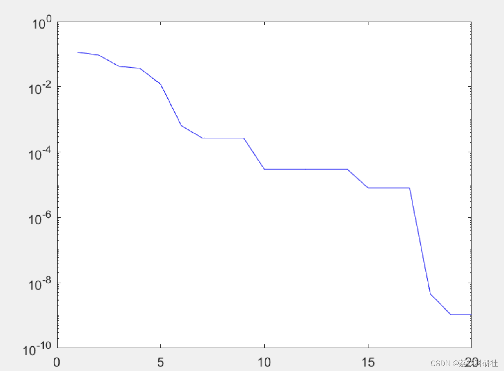
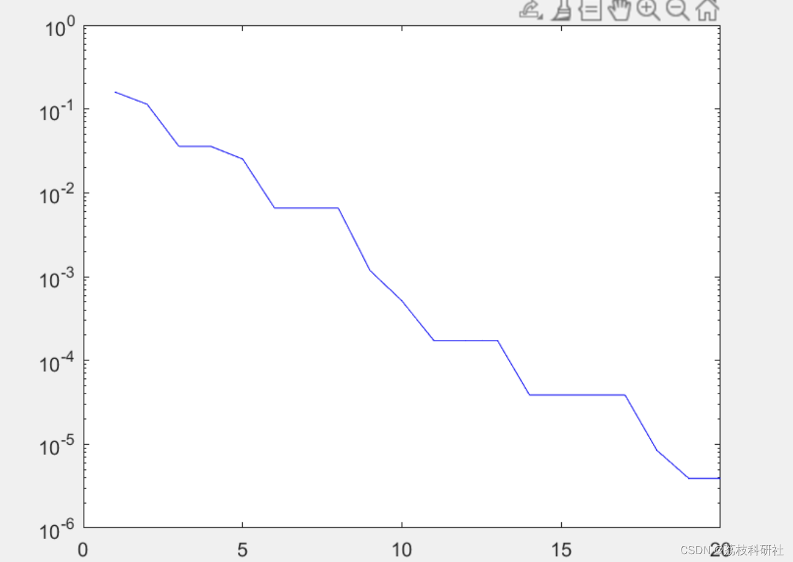

# [Z] Multi-Strategy Coordinated Improvement of Archimedean Optimization Algorithm and Its Application (Matlab Code Implementation)

[1] Luo Shihang, He Qing. Integrating the Sin chaotic and segmented weighted Archimedean optimization algorithm [J]. Computer Engineering and Applications, 2022, 58(14): 63-72. This paper proposes an Archimedean optimization algorithm (CAOA) that integrates chaos theory to enhance the performance of the basic algorithm. The proposed method uses a chaotic map to update candidate solutions with the minimum cost function for specific optimization problems.
The Archimedean optimization algorithm (AOA) was introduced in 2020 by Hashim et al. as a novel metaheuristic algorithm. It adjusts individual density, volume, and acceleration during iterations based on the relationship between the buoyancy force experienced by objects partially or completely submerged in fluids. This process leads to individuals reaching equilibrium, where individuals with higher fitness values guide the population towards the optimal solution, achieving the purpose of optimization. Compared to traditional optimization algorithms, metaheuristic algorithms have fewer control parameters, are easier to implement, exhibit greater randomness, and have strong adaptability. However, like other metaheuristic algorithms, AOA has several shortcomings such as poor global search performance, low solution accuracy, and susceptibility to local optima.
📚2 Run Results Edit
​Edit
Part of the code:
clear;
close all;
clc;
nPop = 100;
Maxit = 20;
nVar = 2; %% number of optimization parameters
C1 = 2; C2 = 6; C3 = 1; C4 = 2; u = .9; l = .1; %%% The parameters of the algorithm
%%%% Initialization
lb = -4.5*ones(1,nVar); %%% same search area for different parameters
ub = 4.5*ones(1,nVar);
% lb=[0*ones(1,D-1),0.000001]; %% different search area for each parameter  
% ub=[5*ones(1,D-1),0.5];  
for i=1:nPop  
X(i,:)=lb+rand(1,nVar).*(ub-lb);  
Y(i)=cost(X(i,:));  
den(i,:)=rand(1,nVar);  
vol(i,:)=rand(1,nVar);  
acc(i,:)=lb+rand(1,nVar).*(ub-lb);  
end  
[Scorebest, Score_index] = min(Y);  
Xbest = X(Score_index,:);  
den_best=den(Score_index,:);  
vol_best=vol(Score_index,:);  
acc_best=acc(Score_index,:);  
acc_norm=acc;  
chnum=1; %%% selection of chaotic map chnum=1,...,10  
chstart=0.65; %%% starting point for chaotic map  
chmap=ch_map(chnum,chstart,Maxit);  
for it = 1:Maxit  
TF(it)=exp(((it-Maxit)/(Maxit)))+(-0.2+0.4*chmap(it)); %%%% TF + chaotic_value  
%  TF(t)=exp(((t-Maxit)/(Maxit))); %%%% Basic algorithm  
if TF(it)>1  
TF(it)=1;  
end  
d=exp((Maxit-it)/Maxit)-(it/Maxit);  
acc=acc_norm;  
r=rand();  
for i=1:nPop  
den(i,:)=den(i,:)+r*(den_best-den(i,:));  
vol(i,:)=vol(i,:)+r*(vol_best-vol(i,:));  
if TF(it) < 0.45  
mr=randi(nPop);  
acc_temp(i,:)=(den(mr,:)+(vol(mr,:).*acc(mr,:)))./(rand*den(i,:).*vol(i,:));  
else  
acc_temp(i,:)=(den_best+(vol_best.*acc_best))./(rand*den(i,:).*vol(i,:));  
end  
end  
🎉3 References
🌈4 Matlab code implementation

## Images

<!-- PAYMENT_BLOCK -->

## Get this dataset

- Payment link (Stripe): [Buy now](https://buy.stripe.com/3cs8yP7sY87d0vu9AB)
- Payment QR code: 

<!-- /PAYMENT_BLOCK -->
